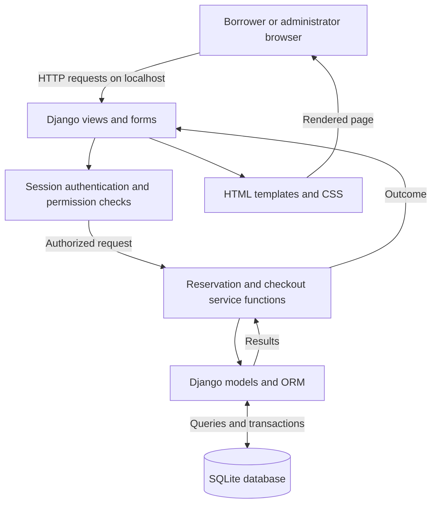
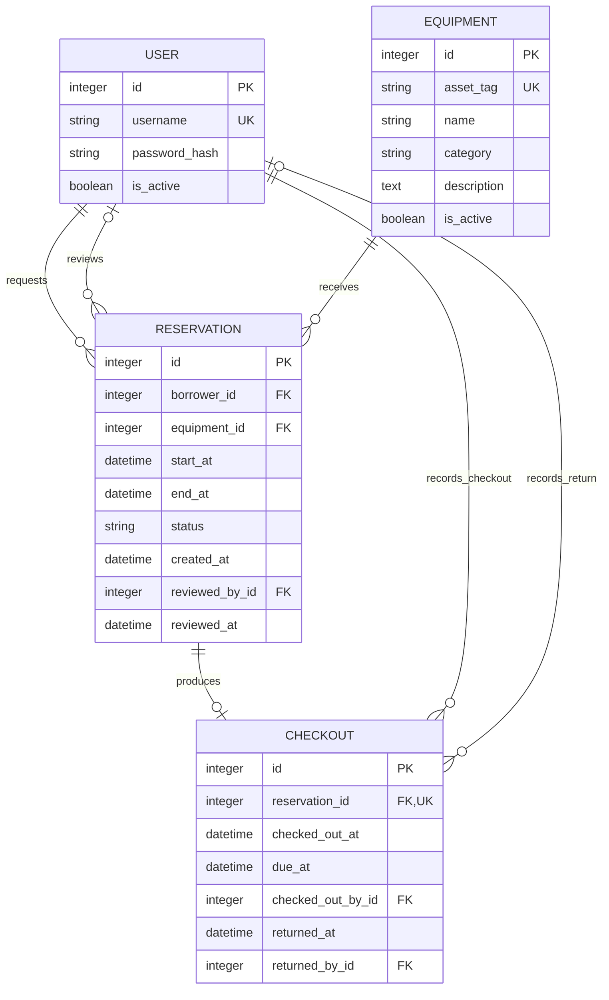

# Campus Equipment Checkout System
## Step 1 planning draft: Architecture, data design, interfaces, and technology

This draft continues the requirements in `01_problem_scope_requirements.md`. It explains how I plan to build the system. I have not implemented or tested this design yet. The diagrams use Mermaid, which GitHub can display in the file preview.

## 5. System Architecture

I plan to build a single Django web application. Borrowers and administrators will use a browser, and Django will render the pages and process form submissions. The browser will not connect directly to the database. This approach lets me run the whole application on my laptop during the classroom demonstration.

### What each part does
- **Browser and templates:** Display equipment, forms, booking status, errors, and administrative lists. Hiding a button is not an authorization control.
- **Views and forms:** Parse input, validate required fields and dates, select the appropriate service operation, and return pages or redirects.
- **Authentication and permissions:** Use Django sessions and framework-managed password hashing. A borrower can access only their own reservations and loans. The equipment-administrator group receives explicit action permissions.
- **Service functions:** Apply approval, cancellation, checkout, and return rules in one place. All operations that change booking or lending state must use these functions.
- **Models and database:** Store related records and enforce keys, valid date ranges, and permitted status values. Migrations will create the schema.

No external API, background worker, or separate frontend application is required. Overdue status will be calculated when the administrator opens the overdue page. The classroom version will run on localhost; internet hosting is outside the initial scope.

### Preventing conflicting approvals
An item may appear available when a borrower searches, but another request could be approved before their request is reviewed. For this reason, the system must check availability again when an administrator approves a request.

I plan to keep the conflict check and approval update inside one short database transaction using `transaction.atomic()` and SQLite's `IMMEDIATE` transaction mode. This lets one writer work at a time, so two approvals cannot both check the same old availability before saving. SQLite does not provide row locking through Django's `select_for_update()`. I still need to test this approach using separate connections to the same database file. [1][2]

Within the transaction, the service will reload the request, verify that it is pending, confirm that the item is active and the start time has not passed, check for overlapping approved reservations, and save approval only if all checks pass. Overlap means:

`existing.start_at < requested.end_at AND existing.end_at > requested.start_at`

Pending, rejected, and cancelled requests do not block a time slot. Two bookings that meet at an endpoint are allowed. A conflicting approval leaves the request pending and returns an explanation; an administrator may reject it separately.

I will set a time limit for waiting on a busy database. If that limit is reached, the application will cancel the operation and ask the administrator to try again. It must not report a successful approval. Transactions will only contain the necessary database work. All booking changes must go through the same service functions, including administrator actions. The overlap rule depends on those functions; the database schema alone will not enforce it.

## 6. Data Design

The application will use relational tables because reservations and loans link specific users to specific equipment. All demonstration records will be fictional. No external dataset is needed.

The two links between a user and a reservation represent different roles: requester and optional reviewer. Checkout and return staff are recorded separately. Django's existing group, permission, and session tables are omitted from this simplified diagram.

### Tables and constraints
| Table | Design and rules |
|---|---|
| User | Use Django's user model through `AUTH_USER_MODEL`. Password hashes are framework-managed, not a custom plaintext password field. Accounts are deactivated instead of deleting loan history. |
| Equipment | `asset_tag` is unique and required. Category is a simple validated field for this version. Deactivation blocks new requests, approvals, and checkouts but preserves history and permits returns. |
| Reservation | Foreign keys link to a borrower and equipment. Status is one of pending, approved, rejected, or cancelled. The database checks `end_at > start_at`. Review staff and time are nullable until a decision is made. Equipment, borrower, and interval are immutable after submission; changes require cancellation and a new request. |
| Checkout | A unique foreign key permits at most one checkout per reservation. Borrower and equipment are obtained through the reservation rather than duplicated. Due time is copied from the reservation end at checkout. Return fields are nullable until return. Require `due_at > checked_out_at`, and, when present, `returned_at >= checked_out_at`. Both return fields must be set together. |

Referenced users and equipment will be protected from deletion. Status choices and date constraints will also be enforced in the database where applicable. Future-start validation uses the current time and belongs in the service rather than a static database constraint.

### State and lending rules
Reservation transitions are `pending -> approved`, `pending -> rejected`, `pending -> cancelled`, or `approved -> cancelled` before checkout. Once any checkout exists, cancellation is forbidden. An approved reservation stays approved after checkout and return; the related checkout provides the lending status. This preserves the approved time interval even after an early return.

Checkout runs inside the same immediate-transaction pattern. It verifies administrator access, active equipment, an approved reservation, `start_at <= now < end_at`, no checkout for that reservation, and no open checkout associated with any reservation for that equipment. Only then is the loan inserted. Return and cancellation use that same serialization approach to avoid racing with checkout.

The system will identify an overdue item when `returned_at IS NULL AND due_at < now`. It will calculate this when needed, because an item can become overdue simply as time passes. An item that has not been returned cannot be checked out again, even if its original booking has ended. Search results will distinguish the booking schedule from whether the item is currently on loan.

### Finding and storing records
- Index reservations by equipment, status, and start time to support conflict lookup; add a borrower index for personal booking history.
- Index checkout due time for overdue queries; the unique reservation reference supports checkout lookup.
- Search by equipment name or category. Count checkouts by equipment and checkout date for the usage report, including equipment with zero loans.
- Use timezone-aware datetimes. Display America/New_York time and normalize instants through Django's timezone support. Reject ambiguous or nonexistent local times rather than silently shifting them. [3]
- Use migrations for schema creation and a documented seed command for synthetic records. Database files and secret configuration will not be committed. Backups must be taken while the application is stopped or through a database-supported backup method.

## 7. Interfaces and Main Screens

The application will use ordinary web pages and forms. The table below lists the planned page addresses and actions. A separate public REST API is not needed for this version.

| Route | Access | Interaction |
|---|---|---|
| `GET/POST /accounts/login/` | Public | Show the login form and authenticate an active account. |
| `POST /accounts/logout/` | Signed-in user | End the session. |
| `GET /equipment/` | Signed-in user | Search by name/category and enter a requested time interval. |
| `GET/POST /reservations/new/` | Borrower | Review an item and submit a request. The server sets the borrower from the session. |
| `GET /reservations/mine/` | Borrower | List own requests and related checkout status. |
| `POST /reservations/{id}/cancel/` | Owner | Cancel a qualifying reservation after ownership and state checks. |
| `GET /staff/requests/` | Administrator | Review pending requests and see conflicts. |
| `POST /staff/requests/{id}/approve/` | Administrator | Recheck availability and approve atomically. |
| `POST /staff/requests/{id}/reject/` | Administrator | Reject a pending request. |
| `POST /staff/requests/{id}/checkout/` | Administrator | Record an eligible loan. |
| `POST /staff/checkouts/{id}/return/` | Administrator | Record return; repeated submission reports that it is already returned. |
| `GET /staff/overdue/` | Administrator | List overdue items, borrowers, and due times. |
| `GET /staff/usage/` | Administrator | Select a date range and view counts per item. |
| `GET/POST /staff/equipment/new/` and `/staff/equipment/{id}/edit/` | Administrator | Create or update inventory. |

All state-changing forms require CSRF protection. Successful submissions redirect to a results page. Invalid form values display an explanation; unauthorized users are redirected to login or receive access denied as appropriate. A borrower requesting another person's record receives no private details. [4]

### Preliminary screen descriptions
**Equipment search:** Name/category filters, start and end fields with timezone labels, and a results table showing asset tag, name, scheduled availability, current loan status, and a request action. No other borrower's identity is shown.

**My reservations:** Item, requested interval, approval status, checkout/return status, and an eligible cancellation action. The page explains that a pending request is not yet confirmed.

**Administrator request queue:** Requester, item, interval, pending status, and approve/reject actions. Conflict feedback identifies the affected item and time interval.

**Checkout and return:** Approved request details and a checkout action; a separate open-loan list provides return actions. Both actions show a confirmation of the resulting state.

**Overdue and usage pages:** Overdue loans show borrower and due time to administrators. The usage page displays per-item checkout counts for the selected date range.

## 8. Technology Stack and Design Decisions

| Choice | Reason and alternative |
|---|---|
| Python and Django | The project needs forms, sessions, permissions, database models, and migrations. Keeping them in one framework reduces integration work. Flask is an alternative, but would require more decisions about these components. Django 5.2 LTS is the proposed series; the actual supported patch and dependencies will be checked and pinned when the proof of concept is created. |
| SQLite | Fits the local, single-department prototype and requires no separate database server. Its write-concurrency limits are a technical risk, so the immediate-transaction design will be tested. PostgreSQL is the alternative if contention or deployment requirements make SQLite unsuitable; adopting it would require revising transaction logic and setup instructions. |
| Django templates, HTML, and CSS | Sufficient for search, forms, and tables without maintaining a separate JavaScript client and API. A React frontend would add work that is not required by the current scope. |
| Django test framework | Planned for service and database tests with isolated synthetic data. Concurrency tests need separate connections and a file-backed database rather than assuming ordinary unit tests prove race safety. |
| Git and GitHub | Store design revisions, source, setup instructions, and actual test evidence as work develops. Commit messages should describe completed changes. |
| Local demonstration | Avoids cloud configuration during the initial assignment. A public deployment, if later required, would need its own security and hosting decisions. |

## Planned Proof of Concept: Next Stage

The next stage will implement only the database-backed reservation approval rule, using the proposed Django/SQLite stack. It will create synthetic equipment and requests and test: overlapping intervals; identical intervals; one interval contained in another; back-to-back bookings; different equipment; pending/cancelled records; invalid intervals; repeated approvals; competing concurrent approvals; and persistence after reconnecting.

A simultaneous-conflict test must verify both the final database state and each operation's outcome. At most one request may be approved; the other must report a conflict or a controlled retry condition. A sequential test alone cannot establish concurrency safety. Source code, exact execution commands, environment versions, and actual output will be recorded after the test is run. Login, UI, checkout workflows, performance, and full security evaluation will remain outside this first proof of concept.

## References
1. Django database documentation, SQLite notes and transaction behavior: https://docs.djangoproject.com/en/5.2/ref/databases/#sqlite-notes
2. SQLite transaction documentation: https://www.sqlite.org/lang_transaction.html
3. Django timezone documentation: https://docs.djangoproject.com/en/5.2/topics/i18n/timezones/
4. Django CSRF documentation: https://docs.djangoproject.com/en/5.2/ref/csrf/

## AI Assistance
I used ChatGPT to help organize this design draft and its diagrams. The design still needs to be reviewed and tested. This document does not report completed tests or interviews with university staff.
